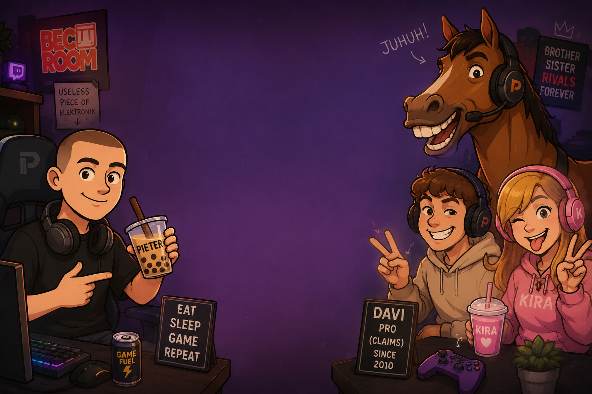

# PieterGame 3

The third game starring **Pieter**, the Dutch meme legend. It follows *PieterGame 1* and *PieterGame 2: Online*.
This one is offline, open source and written in C++20 on a small custom engine (raylib provides the window, input and audio).



## Intro

The first time you launch the game it plays an intro video set to the PieterGame 3 theme, *Stroopwafel Rush*. You can watch it again from Settings. The animation is an engine scene (`src/game/scenes/IntroScene.cpp`) timed to the song's beats (100 BPM, drop at 6.66s). It's rendered offline into `assets/video/intro.mpg` (MPEG-1, decoded in game by [pl_mpeg](https://github.com/phoboslab/pl_mpeg)) plus `intro.ogg`. A shareable `media/PieterGame3_intro.mp4` is written alongside. To re-render (needs ffmpeg; use `xvfb-run` on a headless machine):

```sh
PG_RENDER_INTRO=1 ./build/pietergame3
```

## Game modes

| Mode | What you do |
|---|---|
| **Classic** | The mode that's been in every PieterGame. Dodge enemies for 10 waves. Davi is a miniboss at wave 5, Kira at wave 8, and **The Horse** is the final boss at wave 10. You can't attack, so during boss fights you collect **boba** and it fires at the boss automatically. After you win you can keep going in endless mode. |
| **Pieter Room** | Look after Pieter like a virtual pet. Feed him, pet him, play games with him, scrub him in the shower, put him to sleep and chat with him. His needs keep dropping while you're away. Levelling him up pays out coins. The room follows your real clock: sunrise, sunset and a night sky over a Dutch skyline, and the lights go out when he sleeps. |
| **Horses** | *Bet*: six horses, with odds from a Monte Carlo simulation of the race. Bet to WIN or on TOP 3. *Ride*: you're the jockey racing Davi and Kira. Alternate LEFT/RIGHT to gallop and press SPACE to jump hurdles. |
| **Stroopwafel** | Stack stroopwafels on Pieter's coffee cup. Anything hanging over gets sliced off. Perfect drops build a combo, and every 10 layers earns Pieter a real stroopwafel. |
| **Pieter Beats** | A 4-lane rhythm game on every Pieter song. The charts are generated from the music itself (onset detection + tempo tracking), on Easy, Normal and Hard. Hit notes with D F J K or the arrow keys, hold the long ones, and fill the JUHUH meter for double points. Grades S to F, full combos and personal bests per song. The first play of a song takes a moment while it's analysed; after that it's cached. |
| **Casino** | Roulette (European), Blackjack (Davi deals), Mines and Slots (96.6% RTP, see `tools/slots_rtp.py`). If you go broke, Pieter's pity fund helps you out. |

You earn **Pietercoins** in every mode. Spend them in **Kira's Shop** on Classic powerups, food for Pieter, and cosmetics (hats and trails). Set your powerup loadout and wardrobe in the **Inventory**.

The soundtrack plays the PieterGame OST on the title screen and shuffles through every Pieter song in game. Press **F9** to skip, or pick a song in Settings → Jukebox.

## Discord Rich Presence

While you play, Discord shows what you're doing, for example *Classic - wave 8 / 10 · Fighting KIRA (6 HP left)* or *Taking care of Pieter · Pieter is happy (lvl 4)*, along with how long you've been playing. It talks to the Discord desktop client over its local IPC socket or named pipe, so no SDK is needed. It works with the regular, Flatpak and Snap Discord, and with Vesktop/arRPC. You can turn it off in Settings.

The app ID is set in `src/game/DiscordConfig.hpp`. The images it uses are in `assets/discord/`, made by `tools/make_discord_assets.py`. Upload them in the developer portal under *Rich Presence → Art Assets*, using the file name as the key: `logo`, `horse`, `davi`, `kira`, `casino`, `stroopwafel`. For debugging, `PG_DISCORD_DEBUG=1` prints Discord's replies.

## Controls

| | |
|---|---|
| Classic | WASD / arrows move, SPACE dash, 1 / 2 / 3 powerups, Esc pause |
| Horse ride | alternate LEFT / RIGHT (A / D), SPACE jump |
| Stroopwafel | SPACE or click to drop |
| Everywhere | Esc back, F11 fullscreen, F9 next song |

## Building

You need CMake ≥ 3.20 and a C++20 compiler. If raylib (≥ 6.0) is installed it gets used; if not, CMake downloads raylib 6.0 automatically.

```sh
cmake -S . -B build -DCMAKE_BUILD_TYPE=Release
cmake --build build -j
./build/pietergame3
```

The build copies `assets/` next to the executable, so you can zip and share the `build/` folder.

**Display:** in Settings you can choose Windowed or Fullscreen, which monitor to use, and a resolution from 720p up to your monitor's native resolution. In windowed mode the game renders at the window's real size, so it stays sharp when you resize it. In fullscreen it renders at the resolution you picked and scales that to the monitor. On first launch it opens a window that fits your screen.

Saves go to `~/.local/share/PieterGame3/save.txt` on Linux (`$XDG_DATA_HOME` is respected) and `%APPDATA%/PieterGame3/` on Windows.

## Project layout

```
src/engine/   the "PieterEngine": scenes + fades, virtual-resolution canvas, UI toolkit,
              additive glow / shadows / shockwaves (Fx), post-processing shader, particles, music jukebox, procedural sound synthesizer (Synth.cpp: every SFX is designed in code from oscillators, filters, FM, reverb and echo)
src/game/     profile/save + item database, procedural art (horses, cards, food, hats...), the Pieter Room bedroom (RoomArt)
src/game/scenes/  one file per screen / game mode
assets/       fonts, menu artwork + character portraits, music
tools/        make_sprites.py (cuts portraits from the menu art), make_cutout.py (Pieter's head for the room), slots_rtp.py
```

### Dev hooks

```sh
PG_SCENE=classic PG_WAVE=10 ./build/pietergame3                  # jump straight to the horse boss
PG_SCENE=slots PG_SHOT=out.png PG_SHOT_FRAMES=120 PG_MUTE=1 ...    # headless screenshot (works with xvfb-run)
PG_SCENE=classic PG_GOD=1 PG_SHOT=out.png PG_SHOT_TIME=12 ... # invincible, screenshot after 12s of game time
PG_SCENE=room PG_HOUR=22 PG_ROOM=sleep ...                       # Pieter Room at night, asleep (also shower/feed/chat/play/sad)
PG_SCENE=beats PG_BEATS=3:2 PG_BEATS_AUTO=1 ...                  # Pieter Beats: song 3 on Hard, played by a bot
PG_DUMP_SFX=sfx ./build/pietergame3                              # write every sound effect to sfx/*.wav and quit
```

Scene names: `menu classic room beats horses stroop casino roulette blackjack mines slots shop inventory settings`.

## License

The code is MIT licensed (see `LICENSE`). The Noto Sans fonts use the SIL Open Font License (`assets/fonts/LICENSE`).
The Pieter music and artwork in `assets/music` and `assets/images` belong to the PieterGame project and **aren't** covered by the MIT license.

*Pietercoins are fake. Whatever Pieter says, gambling is not a strategy.*
